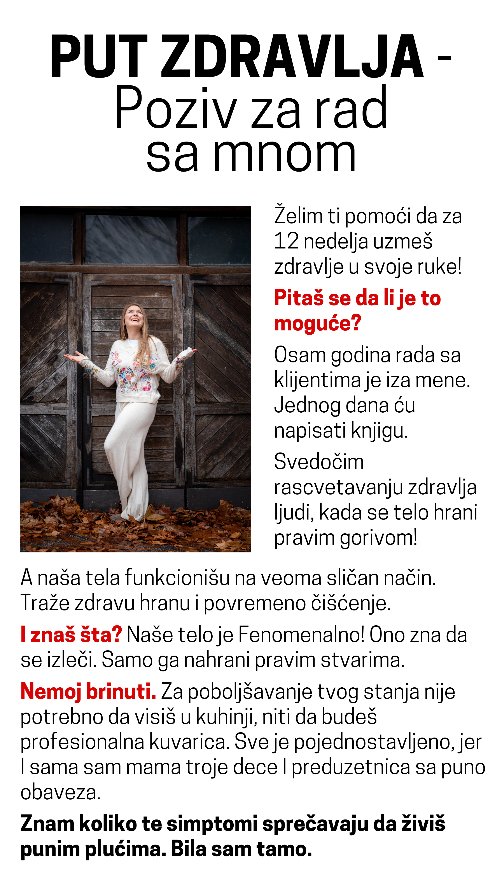
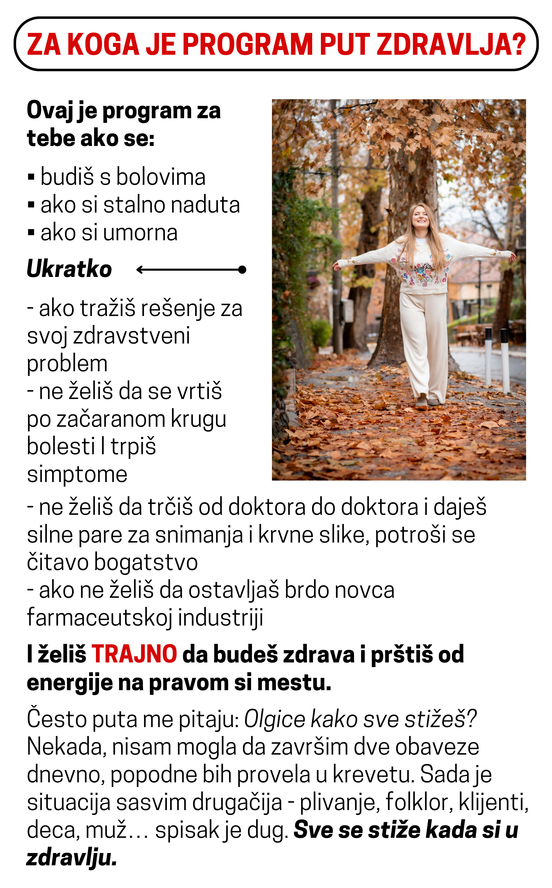
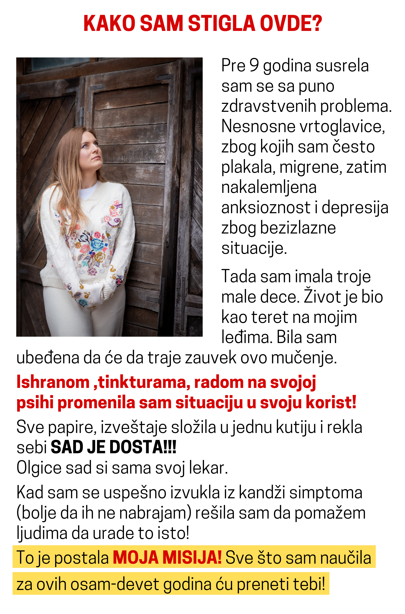
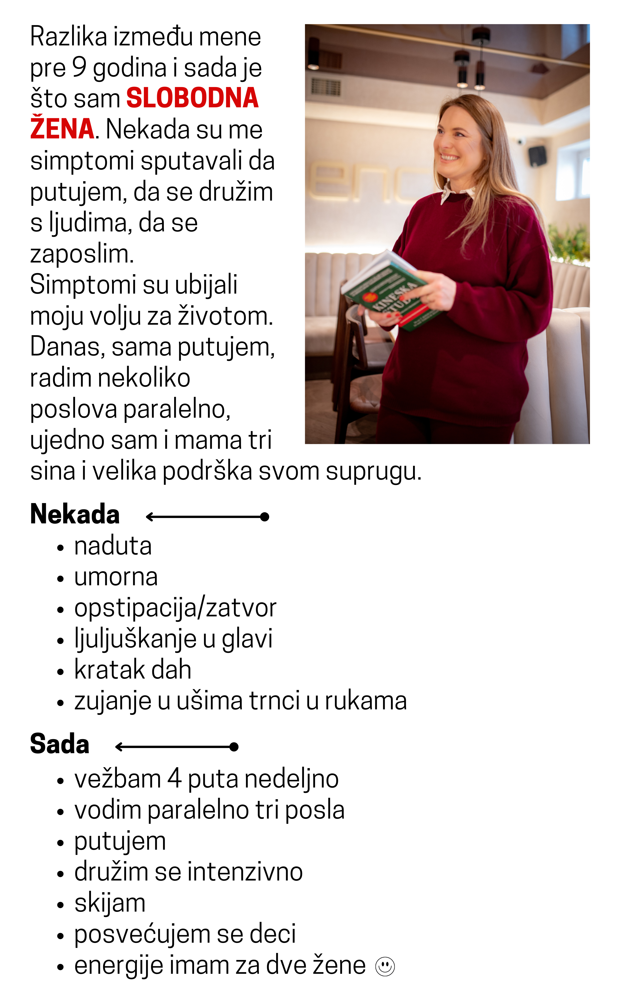
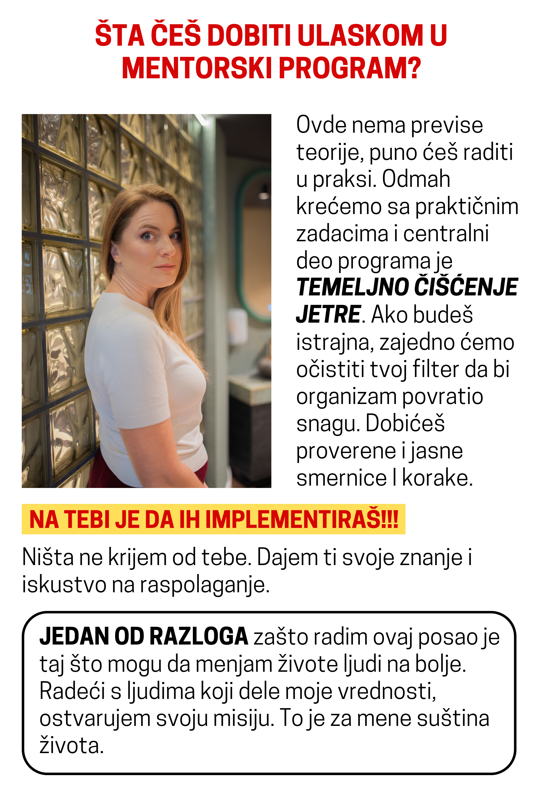
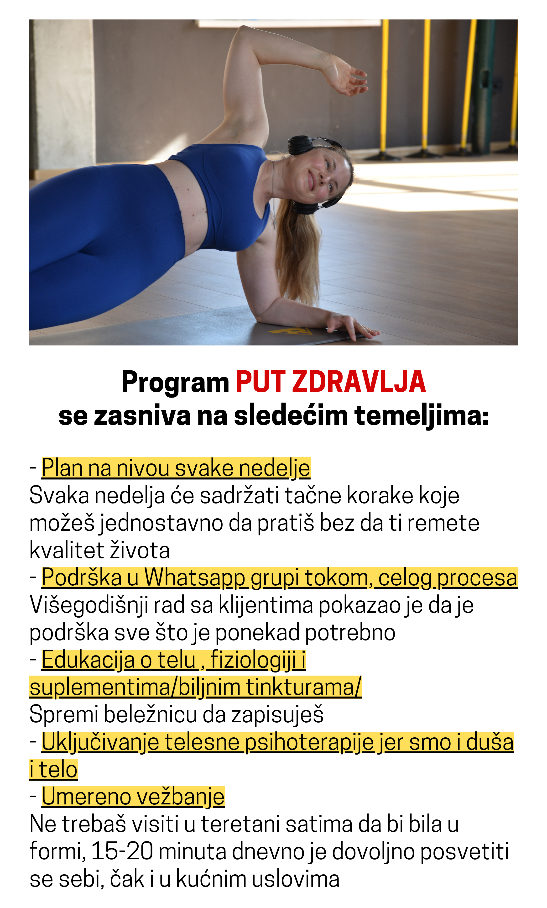
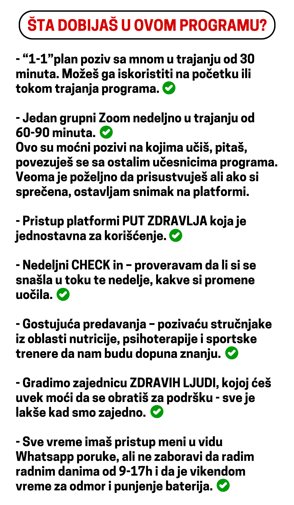
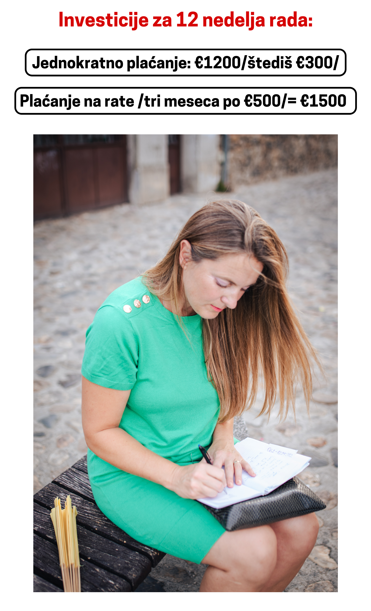
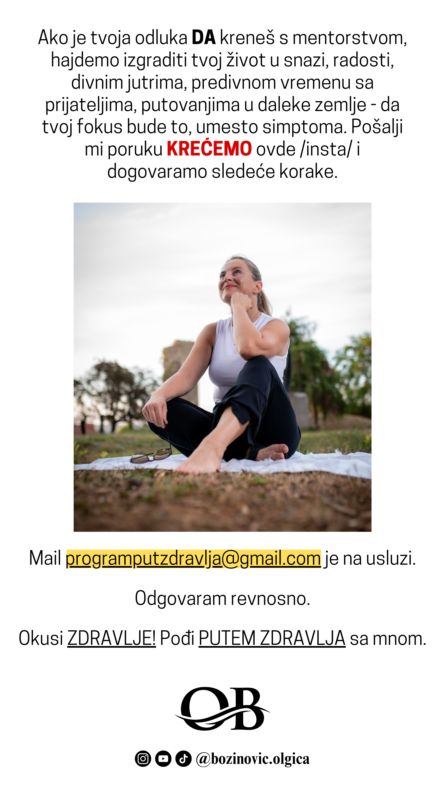

# 

**Pitala bih te da li ti nedostaje:**

–**da se konačno budiš odmorna**

**-da si puna energije**

**-da znaš da spremaš zdrave obroke**

**-da putuješ**

**-da se družiš**

**-da ti se sviđa odraz u ogledalu**

**-da ti hrana nije stress već uživanje**

**Naučiću te kako da uzmeš zdravlje u svoje ruke, spremaš brze, ukusne obroke, kako da temeljno očistiš jetru**

**ZAŠTO JE PUT ZDRAVLJA JEDINSTVEN PROGRAM?**

**Mnogi programi oslanjaju se na razne dijete, gladovanje, metode koje se odnose na samo jedan segment zdravlja.Ovaj program naglašava ODRŽIVOST, zdrav životni stil, dugotrajno zdravlje.**

U ovom programu fokus je na rešavanju **UZROKA** tvojih problema, jer sve što vidimo u klasičnom zdravstvu je maskiranje simptoma lekovima. Nažalost na takav način ne mogu TRAJNO da se reše problemi.

Dok sam pravila program cilj mi je bio da bude jednostavan za praćenje, da bez stresa lagano sklizneš u zdrav lifestyle I da svedočiš kako počinješ da **CVETAŠ!!!**

Program put zdravlja testiran je na više desetina klijenata, I dokazano na najbolji način donosi zdravlje.

Uz pomoć ovog programa posle tri neuspele veštačke oplodnje Maja je zatrudnela u 46.godini I na svet donela Kostu.

Petri su skinuli dijagnozu epilepsije I sad je slobodna žena.

Doktorka Jasmina sa Mejo klinike je izlečila sklerodermu I “neizlečivi” Rejnoldsov sindrom, MArku smo uspeli da zaustavimo progresiju multiple skleroze, rečeno mu je da neće moći nikad da ima dece. Pozvao me je prošle godine da mi kaže da mu je devojka zatrudnela…

Mogla bi dugo da ti pišem o mojim klijentima, ali je sada fokus na tebi! **Da li želiš da se I tvoja priča čuje?**

Nastavi da čitaš 🙂

**ŠTA TI METOD PUT ZDRAVLJA PRUŽA?**

**Ono što je najvažnije je da ti ovaj program pruža PODRŠKU na putu izlečenja. Možda si do sad probala rad sa nutricionistom,dobila plan ishrane kog si se kratko pridržavala I posle sve po starom.**

**Ovaj metod te 12 nedelja studiozno vodi ka izlečenju, postepeno menjajući navike, koje menjaš sa razumevanjem.**

**PUT ZDRAVLJA- Kada ti pokažem pravac I put posle ćeš lako da koračaš samostalno.**

Mnogi programi ne razumeju da smo **DUŠA I TELO**:

Ohrabrujem te da se svojim zdravljem baviš SVEOBUHVATNO.

U ovom programu ti ćeš biti glavni I odgovorni, sam svoj doktor. Ti sebe najbolje poznaješ I ja te učim na koji način da pomogneš sebi.

KLASIČNA MEDICINA TE ŽELI UČINITI ZAVISNIM OD SEBE.

JA TO NE ŽELIM. ŽELIM DA TE OSAMOSTALIM , DA JEDNOM KAD MENE NE BUDE TU PORED TEBE, ZNAŠ SAMOSTALNO PRAVITI DOBRE IZBORE ZA SVOJE ZDRAVLJE.

**ZA KOGA NIJE MOJ PROGRAM:**

U svom programu ne želim ljude koji žele da za dve nedelje reše bolest koja traje 20 godina

Ne želim žene koje nisu borci, žene koje nemaju **ŽAR ZA ŽIVOTOM**.

Postoje “neizlečivi ljudi”.Ja ih tako zovem.To su ljudi koji ne žele ničega da se odreknu u životu, iako im telo daje jasne simptome da im nešto ne prija. Na takve ljude radije ne trošim svoju energiju.

Ovde nećeš dobiti **lažna obećanja I čarobnu pilulu za uspeh .**

Neki klijenti uspeju da se oslobode simptoma već posle mesec dana , a kod nekih to traje mnogo duže.Svako ima **SVOJ PUT IZLEČENJA** I ne treba se upoređivati sa drugima.

Ovo je maratonska trka na duže staze. Ovaj program ti daje znanje I veštine koje ti ostaju za ceo život.

Evo ti jedan savet: Prenesi I na svoju decu jer će u budućnosti biti izazov sačuvati zdravlje .

Moje mentorstvo u ovom program pokriva puno toga ali evo nekoliko područja:

-Posvetiću se tvom zdravlju

Zajedno ćemo definisati šta ti tačno treba od koraka da bi ostvarila svoj cilj

Zatim ćemo sve to upakovati u jednostavan plan I korake koje ćeš raditi posvećeno.

/To je ključ uspeha I RASTA/

Ovaj program treba da bude održiv za tebe.Kako bi smo to postigli potrebni su **TEMELJI.**

Ono što nećeš dobiti

-hrpu nepotrebnih skripti, ne treba ti sadržaj koji će ti trošiti vreme

-garancije niti obećanja bilo koje vrste

U ovaj program sam uložila 100% sebe. Složićeš se da za tvoj kontinuitet I rad ne mogu biti odgovorna. Tvoje je da li ćeš da se pridržavaš plana jer tvoj uspeh zavisi od tvoje predanosti I primeni svega što naučiš tokom edukacije.

Moj je zadatak OSNAŽITI  te  I OSAMOSTALITI, da sutra možeš I bez mene voditi računa o svom zdravlju.

Moji najdraži klijenti sa kojima radim godinama imaju jednu zajedničku crtu-samostalni su I odgovorni za svoje postupke.Želim baš takve ljude u svom programu.

**Koncept programa pročitaj [ovde](https://docs.google.com/document/d/14VvrnmMrjrAY0x-96v0-2Io7zYRUnZ5NtETfd5HguJI/edit?tab=t.0) :**

