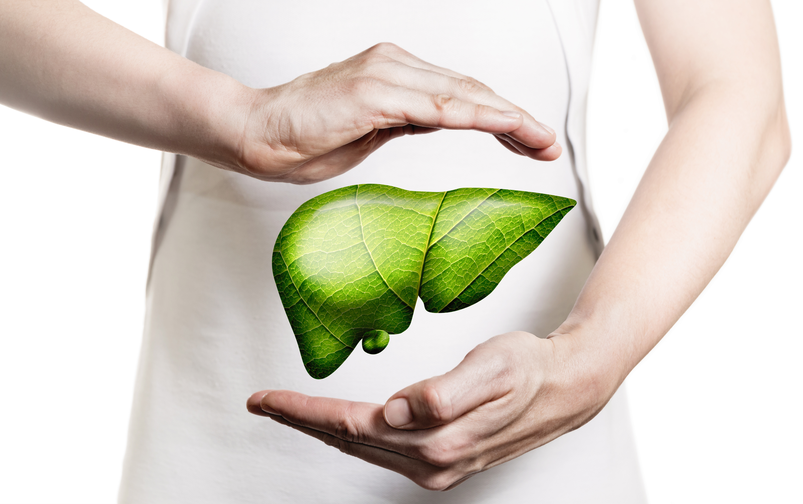

# Protokol čišćenja jetre

Pojednostavljen

Svaka tegoba, od probavne smetnje, čak I do emocionalnih problema, od visokog pritiska, do nefokusiranosti, promena na koži te autoimunih stanja, ima svoje izvorište u preopterećenoj jetri.

Vaša jetra ne odlazi na spavanje kad I vi. Nekoliko se sati odmara, I onda oko 03 ujutru ona se počinje buditi I vraćati na posao.

Jetra zna da u tim trenucima nećete konzumirati tešku hranu, alkohol niti kofein, te da nećete doživeti neki emocionalni događaj koji će izazvati pojačano lučenje adrenalina.

U ranu zoru jetra ima priliku da počisti nered, da skupi svo smeće koje ste prethodni dan uneli u sebe.

Kao prvo jetra voli jutarnju hidrataciju. Kad se probudite vaša krv je zaprljana svim toksinima i otpadom koji je jetra izbacila tokom svoje smene. Ne isperete li taj otpad pomoću dovoljne količine tečnosti, vaša jetra će biti prinuđena da ga ponovo procesuira, što narušava proces izlečenja.

Ujutru, ako konzumirate masnoće-orašasto, jogurt, sir, maslac, jaja, avokado, semenke..jetra se odmah prebacuje na proizvodnju žuči, kako bi mogla probaviti masnoće.Ona nema vremena tada za sopstvenu detoksikaciju i nema prilike za sopstveno čišćenje .

Hidriranjem I izbegavanjem masnoće do 12h jača se IMUNI SISTEM JETRE. Ona ima svoj imuni sistem , i obavlja preko 2000 funkcija u telu.

Tokom protokola čišćenja jetre imamo periode 1.2. 3. dan, zatim 4.5.6.dan i na kraju  7.8.9.dan

Znači 3.dan, pa 6.dan, pa 9.dan to su vremenski periodi kada se dešavaju promene.

U toku protokola primetićete da nema ulja I nema soli, to je zato što želimo da odmorimo jetru od rada. Kada ukinemo masti na 9 dana jetra ima prostora da se odmori, i da se očisti I regeneriše.

Dajemo joj namirnice koje voli. Glukozom iz namirnica je hranimo i dajemo joj priliku za odmor.

Postoji tačno određen spisak namirnica omiljenih jetri.

Prva tri dana-ovo je period kada pokazujemo jetri šta nam je namera. Ona shvata treći dan da mi nešto želimo sa njom da radimo.Ona ne kreće odmah u proces samočišćenja, već prati naša dela.

Kada 4. dana shvati da nismo uneli masnoće ona se priprema za čišćenje. To je jedan inteligentni organ koji neće odmah ispustiti sve otrove koji postoje u njoj jer bi vam u protivnom ugrozio život.

Zato se ona 4.5.6.dan polako priprema za otpuštanje I shvata da je došlo njenih 5 minuta kada može da se posveti sebi i svom čišćenju.

Ovo su dani kada i dalje treba da se pridržavate svega napisanog u protokolu jer sledi najzanimljiviji i najvažniji deo a to je **samo otpuštanje toksina**.

To se sve dešava 7.8.i 9. dan kada jetra konačno se oseća spremnom da se oslobodi I teških metala I masnoća I pesticida, ali kažem, opet sve umereno da vam ne bi ugrozila zdravlje.

U toku ovog čišćenja potpuno je normalno da imate emotivna pražnjenja , najviše bes, jer jetra zadržava u sebi ovu emociju, pa tokom čišćenja očekujte I emotivne izlive.

Ovaj protokol je dobro raditi 2 puta godišnje, a minimum jednom godišnje da bi zdravlje jetre, I celokupnog organizma držali uvek u balansu.

Nekoliko puta godišnje organizujem Program čišćenja jetre, priključite se I vi.

Najpre popunite anketu :

Loading…

Nakon čišćenja, osećaj lakoće u telu je neverovatan, bolja je kosa, ten, energija je na vrhuncu.

I vaša jetra će vam biti zahvalna.
